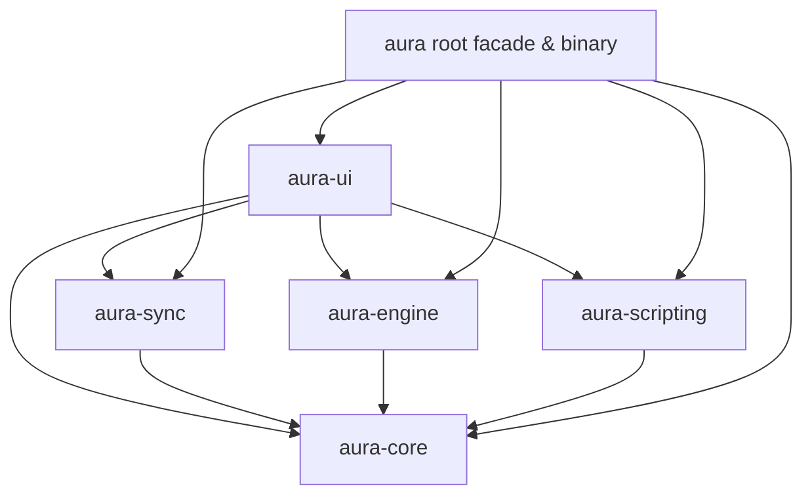

# Design Document: Aura Multi-Crate Workspace & Agents Architecture

**Date:** 2026-10-12  
**Topic:** Multi-Crate Workspace Partitioning and Service-Store & Modular View Architecture Compliance  
**Target:** `aura` REST API Client (`c:\repo\aura`)

---

## 1. Intent & The Why

Aura is a high-performance desktop REST API client built with Rust, GPUI, Tokio, and `deno_core`.

As defined in [`AGENTS.md`](file:///c:/repo/aura/AGENTS.md), the codebase requires strict modularity:
1. **Compilation Ergonomics & Resource Efficiency:** Bundling GPUI (heavy windowing), `deno_core` (v8 runtime), Tokio, reqwest, and all UI views in a single monolithic crate causes extreme memory consumption during compilation and linking (triggering OS paging exhaustion `os error 1455`), slow build times, and poor caching.
2. **Strict Architectural Isolation:** Core domain models and templating must have zero GUI or JavaScript dependencies. `deno_core` must be quarantined in an offline sandbox.
3. **Service-Store & Modular Component Pattern:** Monolithic views (like the 1,000+ line `workspace_view.rs` and god-object `AuraAppState`) must be decomposed into focused Domain Stores (`WorkspaceStore`, `SessionStore`, `LayoutStore`), background Async Services (`ExecutionService`, `WorkspaceService`, `FormatService`), and single-responsibility GPUI views (<= 300–400 lines).

---

## 2. Multi-Crate Workspace Topology

The repository will be structured as a Cargo Workspace with 6 focused crates under `crates/`, with the root `aura` package acting as the application entrypoint and unified facade:

```
c:\repo\aura\
├── Cargo.toml (Workspace Root & Facade / Executable)
├── crates\
│   ├── aura-core\          # Pure domain models, templating, security, interceptors (no GPUI / deno_core)
│   ├── aura-engine\        # HTTP execution (reqwest), collection runner, mock server, logging
│   ├── aura-scripting\     # Deno V8 sandbox runtime (deno_core) strictly offline
│   ├── aura-sync\          # 2-way disk persistence, lossless sync, format importers
│   └── aura-ui\            # GPUI Design tokens, Stores, Services, and Modular Views
└── tests\                  # Cross-crate integration and verification tests
```

### Dependency Graph (DAG)



*Crucial Architecture Benefit:* Notice that `aura-core` has **zero** dependencies on GPUI, Tokio, or deno_core. Its tests run instantly. `deno_core` is isolated to `aura-scripting`.

---

## 3. Crate Responsibilities & Boundaries

### 1. `crates/aura-core`
- **Modules:** `model`, `templating`, `security`, `interceptor`.
- **Dependencies:** `serde`, `serde_json`, `uuid`, `chrono`, `regex`, `base64`.
- **Rules:** Pure Rust business logic. Zero async runtime, zero GUI, zero network.

### 2. `crates/aura-engine`
- **Modules:** `engine`, `runner`, `mock`, `logging`.
- **Dependencies:** `aura-core`, `reqwest`, `tokio`, `tracing`, `tracing-subscriber`, `tracing-appender`, `parking_lot`, `anyhow`, `async-trait`.
- **Rules:** Handles asynchronous HTTP requests, cancellation tokens, collection iteration, and log capture.

### 3. `crates/aura-scripting`
- **Modules:** `scripting`.
- **Dependencies:** `aura-core`, `deno_core`, `anyhow`.
- **Rules:** Sandboxed offline JavaScript execution via `deno_core`. No network primitives exposed.

### 4. `crates/aura-sync`
- **Modules:** `sync`, `importers` (curl, insomnia, openapi, postman).
- **Dependencies:** `aura-core`, `toml`, `serde`, `serde_json`, `anyhow`.
- **Rules:** Filesystem synchronization and format conversion.

### 5. `crates/aura-ui`
- **Modules:**
  - `design`: Color tokens, badge colors, spacing, typography from `DESIGN.md`.
  - `stores`:
    - `WorkspaceStore`: Manages collections, folders, and request files.
    - `SessionStore`: Tracks open tabs, active tab index, dirty states, and close fallbacks.
    - `LayoutStore`: Tracks split ratio (0.1–0.9), orientation (Horizontal/Vertical), and modals.
  - `services`:
    - `ExecutionService`: Coordinates HTTP execution and cancellation handle.
    - `WorkspaceService`: Offloads directory reading and autosave to background threads.
    - `FormatService`: Pretty printing and syntax parsing.
  - `views`:
    - `SidebarView`: Collection tree and folder navigation.
    - `TabBarView`: Tab strip with method badges and dirty indicators.
    - `RequestHeaderView`: Method selector, URL bar, and Send button.
    - `RequestEditorView`: Sub-tabs (Params, Headers, Auth, Body, Scripts, Tests).
    - `ResponsePaneView`: Status badge, metrics, and response tabs (JSON, Headers, Raw).
    - `SplitResizerView`: Hoverable divider with double-click 50/50 reset.
    - `CommandPaletteView`: Keyboard shortcut modal search.
  - `keybindings`: Shortcuts and preset configuration.
  - `workspace_view`: Root coordinator assembling the modular views.
- **Dependencies:** `aura-core`, `aura-engine`, `aura-scripting`, `aura-sync`, `gpui`, `tokio`, `serde`, `serde_json`, `anyhow`.

### 6. Root `aura` Package
- **Role:** Facade re-exporting modules (`pub use aura_core::*`, `pub use aura_engine::*`, etc.) for seamless backwards compatibility with `tests/` and downstream consumers, plus the `main.rs` binary executable.

---

## 4. Gate 1 Architecture Checklist

| Checkpoint | Requirement | Pass Criteria |
|---|---|---|
| **KISS Compliance** | Is the architecture straightforward and minimal? | Yes, 5 focused domain crates + 1 UI crate + root facade. |
| **Module Boundaries** | Are boundaries between UI, engine, and storage clean? | Enforced by crate boundaries: no cycles, pure core. |
| **Premature Abstraction**| Does it avoid unnecessary traits or indirection? | Yes, direct struct ownership and GPUI models. |
| **UI Design System** | Does any UI specification strictly follow `DESIGN.md`? | Color tokens and components imported from `aura-ui::design`. |
| **Offline Sandbox** | Is `deno_core` isolated from external networks? | Quarantined in `aura-scripting` with no network bindings. |

`[GATE 1: PASSED]`
